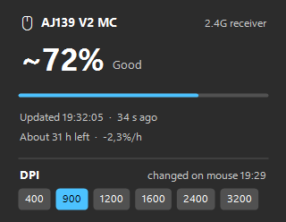

<div align="center">

# AJ139 Battery Tray

**Battery level and DPI stage of the AJAZZ AJ139 V2 MC wireless mouse, in your Windows tray.**

[](https://github.com/DiogoSaraiva14/aj139-battery-tray/actions/workflows/ci.yml)




</div>

The vendor software has no tray mode and no battery percentage, and the USB protocol is undocumented. This app listens to the 2.4G receiver, decodes the mouse's status messages, and shows what it finds.

## Features

- **Tray icon with the battery %.** The colour runs from green to yellow to red as the battery drains, with separate shades for light and dark taskbars.
- **Details panel.** Click the icon for a Windows 11-style panel with the battery, last update, an estimate of time left, and the DPI stages with the active one highlighted.
- **Live DPI.** The active stage updates when you press the DPI button on the mouse.
- **Stable readings.** The mouse reports battery in coarse steps with load dips; the app filters these so the number doesn't jump around (see [Battery display](#battery-display)).
- **Read-only.** It only listens to the receiver and never writes to the mouse.
- **Lightweight.** One ~26 KB exe, ~0% CPU and ~34 MB RAM when idle. The icon appears only while the receiver is plugged in.

<p align="center">
  
</p>

## Quick start

Nothing to install. Windows ships the C# compiler (.NET Framework 4.x) that builds it:

```
build.cmd
AJ139Tray.exe
```

To start it with Windows, put a shortcut to `AJ139Tray.exe` in `shell:startup`, or create a Task Scheduler task with an "At log on" trigger. Keep the exe in a folder you can write to: it stores `log.txt` and `dpi.txt` next to itself.

| Option | What it does |
|---|---|
| `--selftest` | Runs the protocol parser against real captured packets (exit code 0 = OK) |
| `--watch [sec]` | Prints live readings to the console |
| `--preview <dir>` | Renders the icon and panel to PNG files |

## How it works

The receiver (USB `VID 0xA8A5`, `PID 0x2255`) exposes a vendor-defined HID collection on interface `MI_02` (usage page `0xFF01`, 65-byte reports). The mouse sends status messages on it by itself, roughly once a minute and whenever something changes.

| Message | Meaning |
|---|---|
| `AA FA tt xx 38 … D0 pp` | Battery report, sent periodically (`tt` = `00`) and on events (`tt` = `AE`). Byte 10 (`pp`) = battery % |
| `AA FA AE xx 0A … ss` | DPI frame: sent when the DPI button is pressed, and also when the mouse wakes from idle. Byte 10 = current stage (1-based) |
| `AA 0E A5 xx … n a [s1 s2 …]` | DPI settings, sent when the vendor app asks: byte 12 = stage count, byte 13 = active stage, then uint16 LE values |
| `AA 03 …` | Firmware strings (`YJX.co.mouse…`, build dates) |

<sub>Byte offsets include the leading report-ID byte.</sub>

The byte meanings come from watching how values change:

- **Battery:** byte 10 drops slowly with use, reads the same in both message types, and is exactly 100 after a full charge. Byte 4 looked like a percentage at first, but it always equals byte 10 + 11 and reached 111, so it is not a separate reading.
- **DPI button:** the stage number cycles 5 → 6 → 1 → 2 as you press it.
- **DPI settings:** the uint16 values read as 400 / 900 / 1200 / 1600 / 2400 / 3200, which match the vendor app.
- **Wake-up placeholder:** after the mouse has been idle, it sends the DPI frame without any button press, followed by a battery frame whose byte 10 is always `0x50` (80), whatever the real level (120 of 120 in the logs, true level 100% down to 34%). The app drops an 80 that arrives within 2 s of a DPI frame. Otherwise the +10 charge rule would take it for a charge and show ~80% for the next 12 reports.

## Battery display

A full day of raw logs (290 reports, 100% → 90% over about 5 hours) showed:

- **Coarse steps.** The mouse sat at 100%, slid to 90%, then stayed at 90% for almost 4 hours.
- **Short load dips** of 3–20 points that recover on the next report. The value went *up* 57 times during a discharge.
- **About 1.9% per hour** average drain, roughly 50 hours per charge. Over less than a couple of hours the plateaus make any rate meaningless.
- **Pauses** of up to ~16 minutes between reports.

So the app:

- shows the **highest of the last 12 reports** (by count, so pauses don't matter), which removes the load dips;
- **only lets the value go down** between charges. It goes up straight away on a jump of +10, or when all 12 recent reports are above it (a top-up);
- estimates time left from a **straight-line fit over all reports since the last charge**, shown only after 2 hours of data and rounded to hours or days;
- shows the percentage as **approximate** (`~90%`).

Replaying the logged day through this rule gives 100 → 97 → 93 → 90 (3 changes). The previous median-of-5 changed 37 times, 18 of them upward.

## Troubleshooting

| Symptom | Likely cause |
|---|---|
| No tray icon | The receiver isn't plugged in, or isn't the 2.4G receiver (`VID A8A5`, `PID 2255`). Bluetooth isn't supported |
| Icon shows `--` | The receiver is present but no report has arrived yet; the mouse sends one about once a minute |
| Percentage looks stuck | Normal: the mouse reports in coarse steps and the app only moves down between charges |
| Something looks wrong | Check `log.txt` next to the exe: it holds every raw status message, DPI change and read error |

## Repository layout

| Path | Purpose |
|---|---|
| `aj139-tray.cs` | The whole app: receiver reader and battery filter, tray icon, details panel |
| `build.cmd` | Builds `AJ139Tray.exe` with the compiler that ships with Windows |
| `tools/hidprobe.ps1` | Read-only probe used to find the protocol |
| `docs/` | Screenshots |
| `.github/workflows/ci.yml` | Builds and runs `--selftest` on every push and pull request |

`hidprobe.ps1` lists a device's vendor HID channels and logs everything they send:

```
powershell -ExecutionPolicy Bypass -File tools\hidprobe.ps1 -VendorId A8A5 -ProductId 2255 -ListenSec 60
```

## Contributing

Issues and pull requests are welcome. Before sending a change, run `build.cmd` and `AJ139Tray.exe --selftest`; CI does the same. Log excerpts from `log.txt` are the most useful thing to attach to a battery bug.

## Notes

- The protocol was inferred from observation, so the byte meanings are a best reading, not official.
- Only the 2.4G receiver is supported. Over Bluetooth this mouse doesn't expose the standard battery service.
- Not affiliated with AJAZZ.
